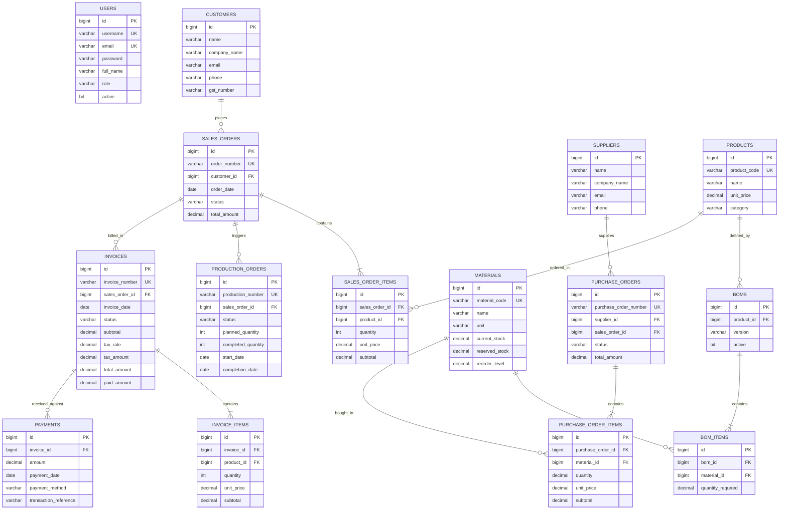
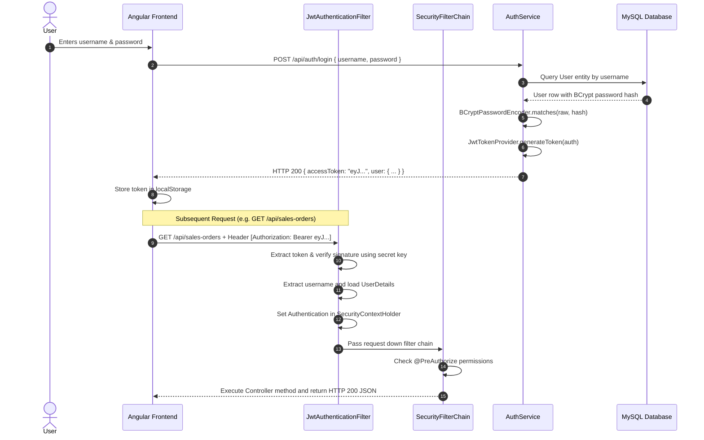
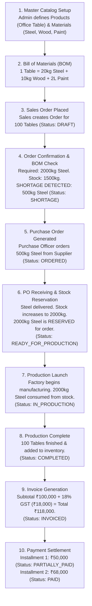

# OrderCraft — Complete Project Notes & Viva Master Guide
**Single Source of Truth for Learning, Viva Defense, and Project Presentations**  
**Student Level:** 2nd / 3rd Year B.Tech Computer Science & Engineering  
**Project:** OrderCraft — Manufacturing Order-to-Cash & Inventory Management System  
**Current Date/State:** October 2026 (React 18 + Vite Frontend verified on Port 3000, Backend verified on Port 8081, MySQL on Port 3306)

---

## 1. Project Overview & Problem Statement

### What is OrderCraft?
OrderCraft is an end-to-end **Manufacturing Order-to-Cash and Inventory Management System**. In a manufacturing environment (such as a furniture manufacturer building office tables and ergonomic chairs), business is not just about shipping pre-made items off a shelf. 

Before a finished product can be delivered:
1. A customer places an order for finished goods (e.g. 100 Office Tables).
2. The factory checks its **Bill of Materials (BOM)** — the precise engineering recipe detailing the raw materials required per finished unit (e.g. 20 kg steel, 10 kg wood, 2 litres paint).
3. The system checks warehouse raw material inventory.
4. If there is a material shortage (e.g. 500 kg steel missing), the system automatically flags the shortage and halts production.
5. A **Purchase Order (PO)** is issued to a vendor/supplier to procure the missing materials.
6. When the shipment arrives, warehouse inventory is incremented and materials are automatically **reserved** for the customer's sales order.
7. A **Production Order** is launched on the factory shop-floor, consuming the reserved stock.
8. Once manufacturing finishes, completed goods are marked ready.
9. An **Invoice** with 18% GST tax calculation is generated.
10. The customer makes payments (partial installments or full settlement), closing the transaction.

### The Real-World Problem Solved
Traditional small-to-medium manufacturing units use disconnected paper logs and separate Excel sheets across departments:
- Sales promises delivery dates without knowing if raw materials exist.
- Warehouse managers manually count stock, leading to unexpected factory halts.
- Purchase officers place emergency orders at high costs.
- Invoicing and payments are tracked in standalone accounting files with no live order linkage.

**OrderCraft solves this** by integrating **Sales, Inventory, Purchasing, Production, and Accounts** into one reactive, automated workflow with role-based access control.

---

## 2. System Architecture (3-Tier Layered Architecture)

OrderCraft is built using the standard **3-Tier Architecture**:

```
+---------------------------------------------------------------------------------+
|                       TIER 1: PRESENTATION LAYER (FRONTEND)                     |
|            React 18 SPA + Vite Dev Server & Build (Running on Port 3000)        |
|     Tailwind CSS | React Router v6 | Axios HTTP Client | AuthContext & Toast    |
+---------------------------------------------------------------------------------+
                                      |
                                      | HTTP REST Requests (JSON Payloads + Bearer JWT)
                                      v
+---------------------------------------------------------------------------------+
|                        TIER 2: APPLICATION LAYER (BACKEND)                      |
|                  Spring Boot 3.4.3 + Java 21 (Running on Port 8081)             |
|                                                                                 |
|   * Controller Layer:   12 @RestController classes (HTTP Routing & DTO mapping) |
|   * Security Filter:    JwtAuthenticationFilter + SecurityFilterChain           |
|   * Service Layer:      12 @Service classes (Manufacturing rules & transactions)|
|   * Repository Layer:   15 @Repository Spring Data JPA interfaces               |
|   * Exception Handler:  @RestControllerAdvice GlobalExceptionHandler            |
+---------------------------------------------------------------------------------+
                                      |
                                      | JDBC Connections (HikariCP Connection Pool)
                                      v
+---------------------------------------------------------------------------------+
|                          TIER 3: DATABASE LAYER (RDBMS)                         |
|                    MySQL Server via XAMPP (Port 3306)                           |
|             Database: `ordercraft` | 15 Relational Tables | InnoDB ACID         |
+---------------------------------------------------------------------------------+
```

### Why 3-Tier Architecture? (Simple Viva Explanation)
1. **Separation of Concerns:** Each layer has a single responsibility. Controllers don't write SQL; repositories don't handle HTTP requests; services don't care about HTML or JSON.
2. **Independent Maintainability:** If we switch the frontend from Angular to React (as we did in this project) or switch the database from MySQL to PostgreSQL, the other tiers remain completely unaffected.
3. **Enhanced Security:** The browser cannot talk directly to MySQL. All database operations are validated and authorized through the Spring Boot backend layer.

---

## 3. Technology Stack & Audit (What We Use & Why)

### Summary Table

| Technology | Role in OrderCraft | Status in Project | Why We Use It |
|---|---|---|---|
| **Java 21** | Backend Programming Language | **Implemented** | Modern LTS Java, robust Object-Oriented structure, strong compile-time type safety. |
| **Spring Boot 3.4.3** | Backend Framework | **Implemented** | Rapid application setup, embedded Tomcat server, dependency injection, zero XML boilerplate. |
| **Spring Web (Spring MVC)** | REST API Engine | **Implemented** | Maps incoming HTTP endpoints (GET, POST, PUT, DELETE) to Java service methods. |
| **Spring Data JPA & Hibernate** | Object-Relational Mapping (ORM) | **Implemented** | Maps Java `@Entity` classes to MySQL tables. Auto-generates SQL queries. |
| **MySQL (Connector/J)** | Relational Database | **Implemented** | ACID-compliant storage for financial transactions, orders, and inventory numbers. |
| **Spring Security 6** | Security & Authorization | **Implemented** | Intercepts requests, protects routes by role, enforces BCrypt password encryption. |
| **JJWT (`io.jsonwebtoken` 0.12.6)** | Token Management | **Implemented** | Generates and validates cryptographically signed HMAC-SHA512 stateless tokens. |
| **Bean Validation (`jakarta.validation`)** | Request Validation | **Implemented** | Validates incoming JSON inputs (`@NotNull`, `@NotBlank`, `@DecimalMin`). |
| **HikariCP** | JDBC Connection Pool | **Implemented** | Default high-performance connection pool included with Spring Boot. |
| **React 18** | Frontend UI Library | **Implemented (Migrated from Angular)** | Simple JavaScript functional components with React Hooks (`useState`, `useEffect`), eliminating complex RxJS observables. |
| **Vite 6** | Frontend Build Tool & Dev Server | **Implemented** | Instant server startup with native ES modules, hot module replacement (HMR), and lightning-fast Rollup builds. |
| **Tailwind CSS 3** | Utility-First CSS Framework | **Implemented** | Consistent, professional dark-sidebar layout without bulky external UI component libraries. |
| **React Router v6** | Client-Side SPA Routing | **Implemented** | Declarative nested routing with `<ProtectedRoute>` for role-based security. |
| **Axios** | HTTP Client | **Implemented** | Promise-based HTTP library with request interceptor for seamless JWT token attachment. |
| **Lucide React** | Icon Library | **Implemented** | Lightweight SVG icons for intuitive manufacturing workflows and status indicators. |
| **Angular 19** | Original Frontend UI | **Replaced & Migrated** | Replaced with React for easier maintainability, readable JavaScript syntax, and straightforward viva defense. |
| **Redux / Zustand** | Global State Managers | **Intentionally Avoided** | Overkill for a college project; React Context API natively handles user auth and toast notifications. |
| **Docker / Microservices** | Containerization / Distributed Systems | **Intentionally Avoided** | Overkill for a single-database college project; adds unnecessary network latency and complexity. |
| **Kafka / RabbitMQ** | Message Queues | **Intentionally Avoided** | Synchronous database transactions are required to prevent inventory race conditions. |

---

## 4. Frontend Deep-Dive (React 18 + Vite + Tailwind CSS Implementation)

The frontend was successfully migrated from Angular 19 to **React 18** using **Vite** and **Tailwind CSS**. Below is the complete architecture and concept breakdown structured for college viva examinations.

### 4.1 Core Concepts Explained (Beginner-Friendly Format)

#### 1. React 18 & Functional Components
- **What is it?** A JavaScript library for building user interfaces using reusable function-based components instead of heavy object-oriented classes.
- **Why are we using it?** Angular required complex TypeScript decorators (`@Component`, `@Injectable`), standalone component boilerplate, and RxJS reactive streams. React uses pure JavaScript functions with React Hooks (`useState`, `useEffect`), making code shorter, cleaner, and much easier to explain in a viva.
- **How is it used in OrderCraft?** Every page (like `Customers.jsx`, `Bom.jsx`, `SalesOrderDetail.jsx`) is a functional React component that manages its own local state with `useState` and fetches data on mount with `useEffect`.
- **Viva line:** *"React uses declarative functional components and virtual DOM reconciliation to build high-performance single page applications with simple JavaScript."*

#### 2. Vite Build Tool & Dev Server
- **What is it?** A next-generation frontend build tool and development server created by Evan You.
- **Why are we using it?** Traditional tools like Webpack and Create-React-App bundle the entire project before starting the dev server, which is slow. Vite serves source code over native ES modules in the browser, providing instant server boot (< 300ms) and instant Hot Module Replacement (HMR).
- **How is it used in OrderCraft?** Configured in `vite.config.js` to serve the React application on port 3000 and reverse-proxy all `/api` requests to the Spring Boot backend on `http://localhost:8081`.
- **Viva line:** *"Vite uses native browser ES modules during development for instant startup and Rollup for optimized production bundling."*

#### 3. Tailwind CSS
- **What is it?** A utility-first CSS framework that provides low-level utility classes like `flex`, `bg-slate-900`, `text-blue-600`, and `rounded-lg` directly in JSX.
- **Why are we using it?** It eliminates writing thousands of lines of custom CSS files and avoids heavyweight, inflexible UI libraries like Angular Material or Bootstrap. It guarantees clean, responsive, and consistent styling across all pages.
- **How is it used in OrderCraft?** Powers the enterprise dashboard theme: dark slate sidebar (`bg-slate-900`), crisp white card containers, intuitive blue primary buttons (`bg-blue-600`), and semantic status badges (green for completed, amber for pending, red for shortages).
- **Viva line:** *"Tailwind CSS allows rapid UI development using utility classes directly in markup, resulting in zero unused CSS in production."*

#### 4. React Router v6 & Protected Routes
- **What is it?** The standard client-side routing library for React single-page applications.
- **Why are we using it?** Enables smooth URL changes (`/dashboard`, `/sales-orders`, `/invoices`) without reloading the entire HTML page from the server.
- **How is it used in OrderCraft?** Defined in `src/App.jsx`. All authenticated pages are wrapped in `<MainLayout>` inside a custom `<ProtectedRoute allowedRoles={[...]}>`. If an unauthenticated user attempts to visit a page, they are redirected to `/login`. If an authenticated user lacks the required role (e.g. Sales user visiting `/invoices`), they are blocked with an "Access Denied" warning.
- **Viva line:** *"React Router manages browser history and client-side navigation, and our ProtectedRoute component enforces role-based access control before rendering page views."*

#### 5. Axios & JWT Request Interceptor
- **What is it?** A popular promise-based HTTP client for the browser and Node.js.
- **Why are we using it?** Axios automatically transforms JSON responses, handles errors cleanly, and supports interceptors to inject headers before requests leave the browser.
- **How is it used in OrderCraft?** Located in `src/services/api.js`. An Axios request interceptor checks `localStorage` for `ordercraft_token`. If found, it automatically attaches `Authorization: Bearer <token>` to the HTTP request headers so every backend endpoint is properly authenticated.
- **Viva line:** *"Axios handles asynchronous HTTP requests, and its request interceptor automatically attaches the JWT bearer token to every outgoing API call."*

#### 6. React Context API (`AuthContext` & `ToastContext`)
- **What is it?** React's built-in state management mechanism for sharing global data across the entire component tree without 'prop drilling' (passing props down through multiple layers).
- **Why are we using it?** To manage user authentication session state (`user`, `token`, `role`) and toast notification messages globally across all pages, without adding complex third-party state libraries like Redux or Zustand.
- **How is it used in OrderCraft?** 
  - `AuthContext.jsx`: Provides `login(username, password)`, `logout()`, `hasRole(role)`, and `hasAnyRole(roles)`. On login, it stores the JWT and user profile in `localStorage` so the session survives browser refreshes.
  - `ToastContext.jsx`: Provides `toast.success(message)` and `toast.error(message)` to display animated, auto-dismissing toast notifications on the top-right corner of the screen.
- **Viva line:** *"React Context API provides lightweight, native global state management for user authentication and UI notifications without third-party library overhead."*

---

### 4.2 Migration Mapping (Angular $\rightarrow$ React)

| Architectural Concept | Angular 19 Implementation | React 18 + Vite Implementation | Benefit in OrderCraft |
|---|---|---|---|
| **View Architecture** | Class components + `@Component` decorator + HTML template | Functional JavaScript Components with JSX | Fewer files, cleaner syntax, no decorators |
| **Reactive State** | RxJS `BehaviorSubject` + Signals | `useState` + `useEffect` Hooks | Pure JavaScript state, no `.subscribe()` memory leaks |
| **HTTP Communication** | Angular `HttpClient` + RxJS Observables | `axios` with Promise `async/await` | Native readable `try/catch` syntax |
| **JWT Interception** | `HttpInterceptorFn` (`jwt.interceptor.ts`) | `axios.interceptors.request.use` | Single centralized Axios instance (`api.js`) |
| **Route Protection** | Functional `CanActivateFn` guards (`auth.guard.ts`) | `<ProtectedRoute>` wrapper component | Clean declarative routing in `App.jsx` |
| **Global State** | Root singleton Services (`@Injectable({ providedIn: 'root' })`) | React Context API (`AuthContext`, `ToastContext`) | Native React pattern, easy state sharing |
| **UI Styling** | Angular Material (`@angular/material`) | Tailwind CSS utility classes | Faster rendering, lightweight bundle, custom dark theme |
| **Icons** | Angular Material `<mat-icon>` | `lucide-react` modern SVG icons | 100% tree-shakeable lightweight SVG icons |
| **Build & Dev Tool** | Angular CLI (`@angular-devkit/build-angular`) | Vite 6 with `@vitejs/plugin-react` | 10x faster dev startup, instant HMR updates |

---

### 4.3 React Application Structure (`frontend/`)

```
frontend/
├── index.html                 # Single HTML entry point (loads /src/main.jsx)
├── vite.config.js             # Vite configuration with /api reverse proxy to port 8081
├── tailwind.config.js         # Tailwind CSS styling and theme configuration
├── postcss.config.js          # PostCSS processor for Tailwind
├── package.json               # Frontend dependencies (React, React Router, Axios, Lucide)
└── src/
    ├── main.jsx               # Application entry point, wraps App with Context Providers
    ├── App.jsx                # React Router route declarations with role guards
    ├── index.css              # Global styles and Tailwind utility directives
    ├── assets/                # Static assets (images, SVGs)
    ├── context/               # Global state providers
    │   ├── AuthContext.jsx    # Session state, login/logout, role checking helper functions
    │   └── ToastContext.jsx   # Non-intrusive floating toast notifications
    ├── services/
    │   └── api.js             # Centralized Axios client & all 12 backend API service calls
    ├── components/            # Reusable UI components
    │   ├── Navbar.jsx         # Top navigation bar with user badge and logout
    │   ├── Sidebar.jsx        # Dark theme sidebar with role-restricted navigation links
    │   ├── ProtectedRoute.jsx # Route authentication & authorization guard component
    │   ├── Modal.jsx          # Reusable modal dialog with backdrop & escape listener
    │   ├── StatusBadge.jsx    # Colored badge component for manufacturing & order states
    │   └── Pagination.jsx     # Spring Data JPA Page compatible table pagination
    ├── layouts/
    │   └── MainLayout.jsx     # Master layout combining Sidebar, Navbar, and <Outlet />
    └── pages/                 # 13 Application Page Modules
        ├── Login.jsx          # User login page with 5 one-click demo credentials
        ├── Dashboard.jsx      # Workflow pipeline visualizer, 6 KPI cards, inventory monitor
        ├── Customers.jsx      # Customer directory CRUD with search and modal dialog
        ├── Products.jsx       # Finished product catalog with role-based price actions
        ├── Materials.jsx      # Raw materials stock, reorder levels & shortage warnings
        ├── Suppliers.jsx      # Raw material vendor directory CRUD
        ├── Bom.jsx            # Multi-item Bill of Materials recipe builder
        ├── SalesOrders.jsx    # Customer sales order list with workflow action buttons
        ├── SalesOrderDetail.jsx # Deep order breakdown, shortage engine & PO generator
        ├── PurchaseOrders.jsx # Supplier procurement orders with "Receive Goods" button
        ├── Production.jsx     # Shop-floor job tracking with "Start Work" & "Complete Run"
        ├── Invoices.jsx       # 18% GST invoice generation, printable invoice view & payments
        └── Payments.jsx       # Historical transaction payment log with method filter
```

---

### 4.4 Role-Based Access Control Matrix

The React frontend enforces the same 5 roles configured in Spring Security:

| Role | Permitted Pages & Workflows in Frontend | Forbidden Areas |
|---|---|---|
| **ADMIN** | Full Superuser Access to all 13 modules and all actions | None |
| **SALES** | `/customers`, `/products`, `/sales-orders`, `/sales-orders/:id` | Raw materials, BOMs, Purchase Orders, Production, Invoices |
| **PURCHASE** | `/materials`, `/suppliers`, `/purchase-orders` (Send & Receive goods) | Sales Orders, Customers, Production floor, Invoices |
| **PRODUCTION** | `/materials`, `/products`, `/bom`, `/production` (Start & Complete runs) | Customer management, Invoices, Payments, Supplier POs |
| **ACCOUNTS** | `/invoices` (Generate invoice & record payments), `/payments` | Manufacturing floor, BOM recipes, Purchase orders |

---

---

## 5. Backend Deep-Dive (Spring Boot 3.4.3 Architecture)

### Core Layer Responsibilities

```
[ HTTP Request: GET /api/sales-orders ]
                 |
                 v
   +---------------------------+
   |   SalesOrderController    |  -> Validates request, checks roles (@PreAuthorize)
   +---------------------------+
                 |
                 v
   +---------------------------+
   |     SalesOrderService     |  -> Business logic, shortage checks, stock calculations
   +---------------------------+
                 |
                 v
   +---------------------------+
   |   SalesOrderRepository    |  -> Extends JpaRepository, executes SQL via Hibernate
   +---------------------------+
                 |
                 v
   +---------------------------+
   |       MySQL Database      |  -> Reads from `sales_orders` and `sales_order_items`
   +---------------------------+
```

### 1. Controllers (`@RestController`)
12 controllers handling HTTP verbs, JSON request bodies, and pagination parameters:
- `AuthController`: User login and session info (`/api/auth`).
- `CustomerController`: Customer directory and address records (`/api/customers`).
- `ProductController`: Finished product catalog and prices (`/api/products`).
- `MaterialController`: Raw material stock, reorder levels (`/api/materials`).
- `SupplierController`: Vendor records (`/api/suppliers`).
- `BOMController`: Bill of Materials recipe definitions (`/api/boms`).
- `SalesOrderController`: Order creation, confirmation, shortage preview (`/api/sales-orders`).
- `PurchaseOrderController`: Raw material purchasing & receipts (`/api/purchase-orders`).
- `ProductionOrderController`: Shop-floor manufacturing execution (`/api/production-orders`).
- `InvoiceController`: GST invoice generation (`/api/invoices`).
- `PaymentController`: Payment recording and balance settlements (`/api/payments`).
- `DashboardController`: Aggregated business KPIs (`/api/dashboard`).

### 2. Services (`@Service` & `@Transactional`)
All database-mutating methods are marked `@Transactional`. If an unexpected error occurs halfway through an operation (for example, deducting stock fails during production start), the entire transaction rolls back automatically, preventing partial corrupt data.

### 3. Exception Handling (`GlobalExceptionHandler.java`)
Uses `@RestControllerAdvice` to catch exceptions globally and convert them into clean HTTP JSON responses (`ErrorResponse`):
- `ResourceNotFoundException` $\rightarrow$ HTTP 404 (e.g. "Customer not found with id: 99")
- `BusinessException` $\rightarrow$ HTTP 400 (e.g. "Insufficient stock to consume for material: Steel")
- `BadCredentialsException` $\rightarrow$ HTTP 401 ("Invalid username or password")
- `AccessDeniedException` $\rightarrow$ HTTP 403 ("Access denied: You do not have permission")
- `MethodArgumentNotValidException` $\rightarrow$ HTTP 400 with a map of field-level validation errors.
- `Exception` $\rightarrow$ HTTP 500 ("An unexpected error occurred")

---

## 6. Database Schema & Entities

The `ordercraft` database consists of **15 relational tables**:



---

## 7. Authentication & Security Flow (JWT & BCrypt)

### Why Stateless JWT?
In traditional server-side applications, the server stores session IDs in RAM. If the server restarts or scales, users get logged out. With **JSON Web Tokens (JWT)**:
1. The server generates an encrypted, digitally signed token containing the user's `username` and `role`.
2. The client stores it in `localStorage` and includes it in the HTTP headers of every request.
3. The server validates the cryptographic signature using its 256-bit secret key without keeping session state in memory.

### Step-by-Step Security Pipeline



### Pre-Seeded Demo Accounts

| Username | Password | Role | Access Scope |
|---|---|---|---|
| `admin` | `admin123` | `ROLE_ADMIN` | Full access across all modules |
| `sales` | `sales123` | `ROLE_SALES` | Customers, Products, Sales Orders, BOM previews |
| `purchase` | `purchase123` | `ROLE_PURCHASE` | Suppliers, Raw Materials, Purchase Orders |
| `production` | `prod123` | `ROLE_PRODUCTION` | BOM creation, Inventory stock, Production Orders |
| `accounts` | `accounts123` | `ROLE_ACCOUNTS` | Invoices, Tax calculations, Payment settlements |

---

## 8. Complete Manufacturing Workflow (Order-to-Cash)

### The 10-Step End-to-End Workflow



### Detailed Business Rules at Each Step
1. **Shortage Calculation Rule:**
   $$\text{Required Stock} = \text{Order Qty} \times \text{BOM Item Required Qty}$$
   $$\text{Available Stock} = \text{Current Stock} - \text{Reserved Stock}$$
   $$\text{Shortage Qty} = \max(0, \text{Required Stock} - \text{Available Stock})$$
2. **Production Block Rule:** If any material has `shortageQuantity > 0`, the system throws `BusinessException("Cannot plan production: Sales order must be in READY_FOR_PRODUCTION status")`.
3. **Stock Reservation Rule:** When all materials are available, `material.reservedStock` increases by the required amount. This prevents two concurrent sales orders from claiming the same steel inventory!
4. **Stock Consumption Rule:** When production starts, `currentStock` and `reservedStock` are both decremented by the consumed quantity.
5. **Tax Calculation Rule:** Invoices calculate tax using standard Indian GST at 18.0%:
   $$\text{Tax Amount} = \frac{\text{Subtotal} \times 18.0}{100} \quad (\text{rounded half-up to 2 decimals})$$
   $$\text{Total Amount} = \text{Subtotal} + \text{Tax Amount}$$
6. **Payment Validation Rule:** Payments cannot exceed the remaining invoice balance:
   $$\text{Remaining Balance} = \text{Total Amount} - \text{Paid Amount}$$

---

## 9. Real Problems Encountered & Debugging Log

Documenting these real technical hurdles demonstrates authentic development and problem-solving during project defense:

### Bug 1: Port 8080 Conflict with Oracle XE Listener
- **Symptom:** Starting backend via Maven resulted in Tomcat crash: `Web server failed to start. Port 8080 was already in use.`
- **Root Cause:** A host system service `OracleXETNSListener` (`TNSLSNR.exe`) was already listening on port 8080 for Oracle XML DB HTTP.
- **Fix:** Overrode the port by passing `SERVER_PORT=8081` when starting Spring Boot without altering configuration files.
- **Viva Lesson:** Understand port binding conflicts and Spring Boot externalized configuration hierarchy (environment variables override property files).

### Bug 2: Frontend "Invalid Credentials" on Admin Login
- **Symptom:** Submitting the correct admin credentials on `http://localhost:4200` always reported `"Login failed: Invalid credentials"`.
- **Root Cause:** Frontend `auth.service.ts` had a hardcoded URL pointing to `http://localhost:8080/api/auth/login`. Requests reached Oracle XE instead of Spring Boot. Oracle returned an HTTP 404 HTML page. Because `err.error?.message` was undefined on HTML, the Angular fallback operator triggered: `this.notify.error(err.error?.message || 'Login failed: Invalid credentials')`.
- **Fix:** Updated `auth.service.ts` and `api.service.ts` to target port `8081`.
- **Viva Lesson:** Always inspect the Network tab in browser Developer Tools to check the real URL and HTTP status code (404 vs 401).

### Bug 3: BOM Loading Crash (`LazyInitializationException`)
- **Symptom:** Opening `/bom` displayed `"Failed to load Bill of Materials"`.
- **Root Cause:** `BOM.items` was mapped with `fetch = FetchType.LAZY` and `spring.jpa.open-in-view=false` was enabled. When `bomService.getAllBOMs()` returned, the transaction closed. Jackson tried to access `bom.getItems()` during JSON serialization, throwing:
  `Could not write JSON: failed to lazily initialize a collection of role: com.ordercraft.entity.BOM.items: could not initialize proxy - no Session`.
- **Fix:** Added `findAllWithItems()` in [`BOMRepository.java`](file:///C:/Users/Divyanshi/OrderCraft/backend/src/main/java/com/ordercraft/repository/BOMRepository.java) using `LEFT JOIN FETCH b.items i LEFT JOIN FETCH i.material` to eagerly fetch items in a single SQL query during the transaction.
- **Viva Lesson:** Eager vs. Lazy Loading in JPA and how Hibernate proxies behave when the persistence context is closed.

### Bug 4: Sales Orders List Crash (`LazyInitializationException` on items)
- **Symptom:** Opening `/sales-orders` displayed `"Failed to load sales orders"` and `"No sales orders found"`.
- **Root Cause:** In [`SalesOrder.java`](file:///C:/Users/Divyanshi/OrderCraft/backend/src/main/java/com/ordercraft/entity/SalesOrder.java), `items` was `fetch = FetchType.LAZY`. When `getAllOrders(search, pageable)` returned paginated results, Jackson failed to serialize `items` because the session was closed.
- **Fix:** Changed `items` in `SalesOrder.java` to `fetch = FetchType.EAGER` and updated `findByIdWithItems` in [`SalesOrderRepository.java`](file:///C:/Users/Divyanshi/OrderCraft/backend/src/main/java/com/ordercraft/repository/SalesOrderRepository.java) to `LEFT JOIN FETCH so.items`.
- **Viva Lesson:** Managing collections with Spring Data JPA pagination without running into detached proxy exceptions.

### Bug 5: Purchase Order & Invoice Crash (`LazyInitializationException` on items) & Java 25 Bytecode Conflict
- **Symptom:** Opening `/purchase-orders` or `/invoices` in the frontend caused HTTP 500 server crashes:
  `Could not write JSON: failed to lazily initialize a collection of role: com.ordercraft.entity.PurchaseOrder.items: could not initialize proxy - no Session`.
  When attempting to recompile the classes using `javac`, the backend JAR refused to launch with `Unsupported class file major version 69`.
- **Root Cause:**
  1. Just like in Bug 4, `PurchaseOrder.items` and `Invoice.items` were mapped as `fetch = FetchType.LAZY`. Under `spring.jpa.open-in-view=false`, the transaction closed before Spring Web's Jackson serializer tried to render the child collection into JSON.
  2. Compiling with host JDK 25 produced major version 69 bytecode, whereas Spring Boot 3.4.3 running on Java 21 expects major version 65.
- **Fix:**
  1. Updated `fetch = FetchType.EAGER` on `items` in both [`PurchaseOrder.java`](file:///C:/Users/Divyanshi/OrderCraft/backend/src/main/java/com/ordercraft/entity/PurchaseOrder.java) and [`Invoice.java`](file:///C:/Users/Divyanshi/OrderCraft/backend/src/main/java/com/ordercraft/entity/Invoice.java).
  2. Recompiled classes strictly targeting Java 21: `javac --release 21 -cp "target/classes;BOOT-INF/lib/*"` and updated the JAR archive using `jar uf`.
- **Viva Lesson:** Always match target bytecode release (`--release 21`) to the runtime JVM, and ensure collections serialized by REST controllers outside of transactions are eagerly initialized or fetched.

### Bug 6: React Frontend Login Rejection (`HTTP 403 Forbidden` on CORS Origin)
- **Symptom:** In the React frontend (`http://localhost:3000`), submitting the login form returned `Request failed with status code 403`. Direct terminal API calls without an `Origin` header worked, but real browser requests failed.
- **Root Cause:** In [`WebConfig.java`](file:///C:/Users/Divyanshi/OrderCraft/backend/src/main/java/com/ordercraft/config/WebConfig.java), `allowedOrigins` was hardcoded to the former Angular development port (`http://localhost:4200`, `http://127.0.0.1:4200`, `http://localhost:80`). Browsers automatically attach `Origin: http://localhost:3000` to HTTP requests. Because port 3000 was absent from `WebConfig`, Spring Security's CORS processor rejected the browser request with HTTP 403 before it reached `AuthController`.
- **Fix:** Added `"http://localhost:3000"` and `"http://127.0.0.1:3000"` to `allowedOrigins` in `WebConfig.java`, rebuilt the JAR via Maven, and restarted the backend.
- **Viva Lesson:** Understanding browser Cross-Origin Resource Sharing (CORS) security, the `Origin` header lifecycle across frontend dev proxies, and configuring Spring MVC `CorsRegistry` to match the frontend development server port.

---

## 10. Design Decisions & Trade-Offs

### 1. Why Java and Spring Boot instead of Node.js/Express?
- **Decision:** Spring Boot provides strict compile-time type safety, structured 3-tier layering, and transactional guarantees (`@Transactional`). In manufacturing systems where inventory and financial updates must never be partially applied, Spring's transaction manager provides rock-solid consistency.

### 2. Why MySQL instead of MongoDB (NoSQL)?
- **Decision:** OrderCraft relies heavily on relational integrity. A Sales Order item must reference a valid Product; a Purchase Order must reference a valid Supplier; a BOM Item must reference a valid Material. Foreign keys and ACID transactions in MySQL prevent orphaned records and corrupt data.

### 3. Why JPA/Hibernate instead of Raw JDBC?
- **Decision:** Raw JDBC requires hundreds of lines of boilerplate `PreparedStatement`, manual connection closing, and tedious `rs.getString()` mapping. Hibernate automates mapping, handles type conversions, and generates optimized queries while preventing SQL injection.

### 4. Why JWT instead of HTTP Session Cookies?
- **Decision:** Session cookies require server-side state in RAM. If the backend restarts, user sessions are lost. JWT is stateless; the server simply validates the signature on every request, making it lightweight and REST-compliant.

### 5. Why Monolithic 3-Tier instead of Microservices?
- **Decision:** For a system with 15 relational entities, microservices introduce distributed network latency, API gateway overhead, and distributed transaction complexity (Saga pattern). A single clean Spring Boot monolith running on MySQL is faster, easier to debug, and simple to explain.

### 6. Why React + Vite replaced Angular for the Frontend?
- **Decision:** Angular requires learning TypeScript decorators, Dependency Injection, Standalone components, and complex RxJS Observable streams (`.pipe()`, `.subscribe()`). React uses clean JavaScript functions with Hooks (`useState`, `useEffect`) and native `async/await`, making the frontend simpler for B.Tech students to understand and defend. Vite provides instant sub-second development server startup and lightning-fast HMR compared to Angular CLI.

### 7. Why React Context API instead of Redux or Zustand?
- **Decision:** Redux introduces heavy boilerplate (reducers, actions, dispatch, slices, middleware) which is unnecessary for a 3rd-year college project. OrderCraft only requires global state for two things: user authentication session (`AuthContext`) and toast notifications (`ToastContext`). React Context API natively handles both with zero external libraries.

### 8. Why Tailwind CSS instead of Angular Material or Bootstrap?
- **Decision:** Component libraries like Angular Material or Bootstrap impose rigid styling and heavy CSS bundles that are hard to customize. Tailwind CSS provides utility-first classes directly in JSX, enabling a sleek, custom enterprise dashboard aesthetic (dark slate sidebar, crisp data tables, colored status badges) with a tiny 30 kB production CSS footprint.

---

## 11. Viva Questions & Answers (Examiner Defense Guide)

### Q1: What is a Bill of Materials (BOM) and why is it critical in this project?
- **Simple Answer:** A BOM is the engineering formula or recipe for a manufactured product. It lists all raw materials and exact quantities needed to build 1 unit of that product.
- **If examiner asks deeper:** In OrderCraft, 1 Office Table requires 20 kg steel, 10 kg wood, and 2 L paint. When an order for 100 tables is placed, the BOM allows the system to compute the total raw material footprint ($100 \times 20 = 2000$ kg steel), compare it to current inventory, and determine if an automated shortage warning must be triggered.

### Q2: What is the difference between `@ManyToOne` and `@OneToMany`?
- **Simple Answer:** `@ManyToOne` indicates multiple child records link to a single parent (e.g. many line items belong to one Sales Order). `@OneToMany` indicates one parent holds a list of children (e.g. one Sales Order contains multiple line items).
- **If examiner asks deeper:** In the relational database, the foreign key column (`sales_order_id`) always resides on the child table (`sales_order_items`). In Java, the parent entity declares `@OneToMany(mappedBy = "salesOrder")` to show that the child entity owns the relationship.

### Q3: What is the purpose of `@Transactional` in your service classes?
- **Simple Answer:** It ensures that a group of database actions either all succeed together or all roll back together if an error occurs.
- **If examiner asks deeper:** In `startProduction()`, the system must deduct material from `currentStock`, deduct from `reservedStock`, update the `ProductionOrder` status, and update the `SalesOrder` status. If the server crashes halfway through, `@Transactional` ensures no partial changes are saved, keeping inventory counts consistent.

### Q4: How does BCrypt password hashing protect user accounts?
- **Simple Answer:** BCrypt is a one-way cryptographic hash with random salt. Plain passwords are never saved in the database.
- **If examiner asks deeper:** Even if two users share the same password `admin123`, their BCrypt hashes in MySQL look completely different because each hash includes a unique random 128-bit salt and multiple computation rounds (work factor 10). It is computationally infeasible to reverse-engineer the password.

### Q5: How does OrderCraft prevent two orders from taking the same inventory?
- **Simple Answer:** By using a **Reserved Stock** field in the `materials` table.
- **If examiner asks deeper:** Available stock is calculated as `currentStock - reservedStock`. When an order is confirmed and sufficient stock is found, the system immediately adds the required quantity to `reservedStock`. Subsequent orders calculate availability against the remaining unreserved stock, preventing over-commitment.

### Q6: What is a DTO and why do you use it instead of passing Entities directly?
- **Simple Answer:** DTO stands for Data Transfer Object. It is a lightweight object designed solely to carry data between the client and server.
- **If examiner asks deeper:** Passing Entities directly in controllers is dangerous because clients could modify sensitive internal fields (like `id` or `status`). DTOs allow strict input validation using `@NotNull` and `@DecimalMin`, and prevent circular reference issues during JSON serialization.

### Q7: Why did you migrate the frontend from Angular to React?
- **Simple Answer:** React provides simpler JavaScript code, functional components with hooks, and avoids complex RxJS observables, making the application easier to build and defend in a viva.
- **If examiner asks deeper:** Angular relies on TypeScript decorators, standalone components, dependency injection, and RxJS subscription streams. React provides a cleaner mental model using native JavaScript `async/await` with Axios, React Hooks (`useState`, `useEffect`), and a fast build tool in Vite.

### Q8: How does JWT authentication and route protection work in React?
- **Simple Answer:** The JWT token is saved in `localStorage` upon login. An Axios request interceptor attaches it to every API call, and a `<ProtectedRoute>` component verifies the token and role before rendering private pages.
- **If examiner asks deeper:** When a user logs in, `AuthContext` saves the JWT string and user object in `localStorage`. If an unauthenticated user accesses `/dashboard`, `<ProtectedRoute>` checks `isAuthenticated`. If false, it redirects to `/login`. If the user is authenticated but visits a page outside their allowed roles (e.g. a Sales user accessing `/invoices`), `<ProtectedRoute>` renders an "Access Denied" message.

### Q9: What is an Axios request interceptor and why is it used?
- **Simple Answer:** An interceptor is middleware for HTTP calls. It intercepts every outgoing request before it leaves the browser to inject headers or check state.
- **If examiner asks deeper:** In `src/services/api.js`, `apiClient.interceptors.request.use` checks `localStorage.getItem('ordercraft_token')`. If the token exists, it appends the `Authorization: Bearer <token>` header to the request configuration. This avoids having to manually type authentication headers into every single API call across 13 modules.

### Q10: How do you prevent prop drilling in React without using Redux?
- **Simple Answer:** We use the built-in **React Context API** (`createContext` and `useContext`).
- **If examiner asks deeper:** Prop drilling is the tedious process of passing props through intermediary components that do not need them just to reach a deeply nested child. By wrapping our application in `<AuthProvider>` and `<ToastProvider>`, any component at any level can simply call `useAuth()` or `useToast()` to access authentication and notification actions directly.

### Q11: What was the `LazyInitializationException` and how did you resolve it?
- **Simple Answer:** Hibernate closed the database session before the web framework finished converting related items to JSON, throwing an error. We resolved it by eagerly loading the items.
- **If examiner asks deeper:** With `spring.jpa.open-in-view=false`, the Hibernate session closes immediately when the `@Transactional` service method completes. Because collections like `PurchaseOrder.items` were marked `FetchType.LAZY`, Jackson's JSON serializer attempted to initialize the uninitialized Hibernate proxy outside of an active session. Setting `FetchType.EAGER` on the parent entities ensures items are retrieved in the initial SQL query while the session is open.

---

## 12. Presentation Slide-by-Slide Guide

1. **Slide 1: Title & Team**
   - Project: *OrderCraft — Manufacturing Order-to-Cash & Inventory Management System*
   - Team & Academic Details (3rd Year B.Tech CSE).
2. **Slide 2: The Problem in Manufacturing**
   - Disconnected spreadsheets between Sales, Warehouse, Purchasing, and Billing cause stockouts, late deliveries, and manual billing errors.
3. **Slide 3: Project Objectives**
   - Automate BOM material requirement checks.
   - Detect raw material shortages before production starts.
   - Streamline Purchase Orders, Production floor tracking, and 18% GST Invoicing.
4. **Slide 4: System Architecture**
   - 3-Tier Architecture diagram (React 18 + Vite SPA $\rightarrow$ Spring Boot REST API on port 8081 $\rightarrow$ MySQL Database).
5. **Slide 5: Key Modules**
   - Customer & Supplier Master Data
   - Raw Materials & Finished Products
   - Bill of Materials (BOM) Engine
   - Sales Order Lifecycle with Shortage Engine
   - Purchase Orders & Receiving
   - Production Orders & Shop-floor consumption
   - Invoices (GST 18%) & Payment Tracking
6. **Slide 6: Live Workflow Demo**
   - Place Order for 100 Tables $\rightarrow$ Show 500kg Steel Shortage $\rightarrow$ Generate Purchase Order $\rightarrow$ Receive PO & Reserve Stock $\rightarrow$ Start Production $\rightarrow$ Generate Invoice $\rightarrow$ Record Payment.
7. **Slide 7: Technical Highlights & Security**
   - Stateless JWT authentication with BCrypt encryption.
   - Role-Based Access Control (5 distinct roles: ADMIN, SALES, PURCHASE, PRODUCTION, ACCOUNTS).
   - Atomic database transactions using Spring `@Transactional`.
   - Clean, lightweight React UI with Tailwind CSS.
8. **Slide 8: Conclusion & Future Scope**
   - Successful migration from Angular to React with zero backend API breakage.
   - Automated PDF download for GST invoices.
   - Barcode scanning for warehouse receiving.

---

## 13. Current Project Status & Roadmap

- **Completed & Runtime-Verified:**
  - **Database Tier:** MySQL database (`ordercraft`) running on port 3306 with 15 relational tables and sample manufacturing seed data.
  - **Backend Tier:** Spring Boot 3.4.3 REST API running live on `http://localhost:8081` with JWT authentication, role-based security, and 12 functional REST controllers.
  - **Frontend Tier:** React 18 + Vite SPA live on `http://localhost:3000` with Tailwind CSS, React Router v6, Axios interceptor, and AuthContext.
  - **All 13 Modules Migrated & Verified:**
    1. Login (with 5 one-click role demo profiles)
    2. Dashboard (Pipeline visualizer, 6 KPI cards, inventory monitor)
    3. Customers (CRUD with search and modal dialogs)
    4. Products (Product catalog with price management)
    5. Materials (Raw material directory with available/reserved stock tracking)
    6. Suppliers (Raw material vendor directory)
    7. Bill of Materials (BOM multi-item recipe builder)
    8. Sales Orders (Paginated browsing, creation, workflow status actions)
    9. Sales Order Detail (BOM shortage detection engine & 1-click PO generator)
    10. Purchase Orders (Procurement orders with goods receipt & stock increment)
    11. Production Orders (Shop-floor work tracking, "Start Work" and "Complete Run")
    12. Invoices (18% GST tax calculation, printable tax invoice format)
    13. Payments (Historical payment transaction log and method tracking)
  - **Build Verification:** `npm run build` generates 0 errors and production bundle (`dist/`).
  - **Deprecated Angular Frontend:** Completely replaced and cleaned up.

